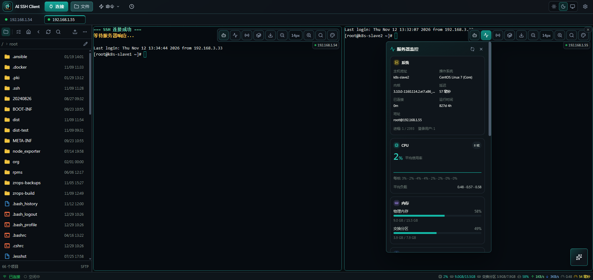
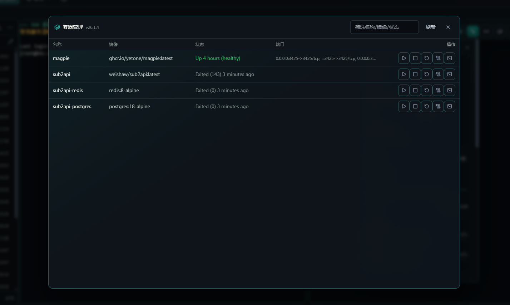

# AI SSH Client

A self-hosted, browser-based SSH workspace: a full terminal, SFTP file manager, server monitoring, Docker management and an optional AI assistant — all served from a single Node.js process. No desktop install; open a URL and work.

<p align="center">
  
</p>

<p align="center">
  
</p>

## Table of Contents

- [Features](#features)
- [Screenshots](#screenshots)
- [Getting Started](#getting-started)
- [Docker / Web Deployment](#docker--web-deployment)
- [Security](#security)
- [MCP for AI Agents](#mcp-for-ai-agents)
- [Keyboard Shortcuts](#keyboard-shortcuts)
- [Tech Stack](#tech-stack)
- [Project Structure](#project-structure)
- [Development](#development)
- [Data and Backups](#data-and-backups)
- [Contributing](#contributing)
- [License](#license)

## Features

- **Multi-session SSH** — password and private-key auth, jump hosts, HTTP / SOCKS5 proxies, reconnect and keepalive.
- **Split terminal workspace** — drag tabs to split left/right/up/down, up to four panes side by side, each labelled with its server.
- **Rich terminal** — xterm.js with search, themes, configurable font and scrollback, command history, autocomplete, bracketed paste and a full-screen-program-safe input mode.
- **Session-bound SFTP** — browse, upload, download, edit, rename and change permissions; recursive folder transfer, remote file preview (images, PDF, audio/video streaming) and remote file search.
- **Transfer queue** — per-task and bulk pause / resume with real resumable transfers, plus preserved source mtime on upload.
- **Port forwarding** — local and dynamic SOCKS5 forwards managed from the terminal toolbar.
- **Server monitoring** — live CPU per core, memory, swap, network throughput, disk I/O, load, processes and latency in the status bar.
- **Docker management** — list, inspect, start / stop / restart containers, stream logs over SSE and open a container shell.
- **Sudo file access** — edit root-owned files through `sudo` without leaving the browser (password prompted on demand, never stored).
- **Command broadcast** — type once and send the same input to every visible split pane.
- **AI assistant & agent** — natural-language Linux help and guided task execution through guarded command steps.
- **Multiple AI providers** — OpenAI-compatible endpoints, Anthropic, Gemini and Ollama.
- **Guardrails** — command risk analysis with approval gates for dangerous operations, plus execution logging.
- **Host fingerprint verification** — SHA-256 host-key check with a trust-on-first-use prompt.
- **Quick commands** — reusable shell snippets organised into groups.
- **Themes and design tokens** — light, dark and system themes driven by a single token system.
- **Portable config** — import and export application configuration, including OpenSSH `config` import.

## Screenshots

<div align="center">
  
  <br /><br />
  
</div>

## Getting Started

Requires Node.js 20+.

```bash
npm install

# build the browser bundle, then start the web server on http://localhost:5080
npm run web
```

`npm run web` builds the renderer and launches `server/index.cjs`. For frontend-only
development, run `npm run dev:vite` for the Vite dev server against a running
`npm run web:only` backend.

## Docker / Web Deployment

```bash
docker compose up -d --build
```

Open <http://localhost:5080>. Set `AI_SSH_CLIENT_WEB_PORT` to change the host port.
From another device on the same LAN, open `http://<laptop-ip>:5080`; enable the
HTTPS listener (`AI_SSH_CLIENT_WEB_TLS=1`) if SFTP downloads must work from
non-localhost origins (browsers restrict the File System Access API to secure
contexts).

Common settings:

| Variable | Purpose |
| --- | --- |
| `AI_SSH_CLIENT_WEB_PORT` | Host port mapped to the container's `5080`. |
| `AI_SSH_CLIENT_WEB_PASSWORD` | Password for the web UI (passed to the container as `WEB_AUTH_PASSWORD`). |
| `AI_SSH_CLIENT_WEB_TLS` | `1` generates a self-signed certificate on first start (`WEB_TLS`). |
| `WEB_TLS_CERT` / `WEB_TLS_KEY` | Bring your own PEM certificate instead of self-signing. |
| `WEB_TLS_HOSTS` | Comma-separated hostnames / IPs for the self-signed certificate SAN. |
| `WEB_TLS_REGENERATE` | `1` forces regeneration of the self-signed certificate. |
| `WEB_HOST` | Bind address (`0.0.0.0` to expose on the network; already set under Docker). |
| `DATA_DIR` | Persistence directory (connections, settings, transfers, TLS material). |
| `WEB_SSH_TRUST_ON_FIRST_USE` | `true` to auto-trust hosts without a stored fingerprint. |
| `MCP_ALLOW_EXEC` | `1` enables MCP command execution (off by default). |

Certificates are stored in `DATA_DIR/tls/` and reused until they expire, the
volume is removed, or the browsed IP changes. To terminate TLS yourself, put a
reverse proxy (for example Caddy) in front of `127.0.0.1:5080`.

## Security

- **Host key verification** — every connection is checked against a stored
  SHA-256 fingerprint; unknown hosts prompt for trust-on-first-use.
- **Encrypted credentials** — SSH passwords, private keys and AI API keys are
  encrypted with AES-GCM before being written to disk (`server/secret-store.cjs`).
- **Password management** — pin the web password with `WEB_AUTH_PASSWORD`; the
  encryption key is derived from it. Changing or losing it makes previously
  stored secrets unreadable.
- **HTTPS for file downloads** — the File System Access API requires a secure
  context; use `WEB_TLS=1` or a TLS-terminating proxy for LAN access.

## MCP for AI Agents

`server/mcp/index.mjs` is an optional **stdio MCP server** exposing saved
Web-mode connections to MCP clients such as Claude Code, Cursor and DSH. The Web
gateway also serves a **Streamable HTTP endpoint at `/mcp`**
(`Authorization: Bearer <web password>`), so a client only needs the URL while
connections and policy stay server-side.

```bash
npm run mcp          # local stdio (needs access to the data directory)
npm run web          # gateway exposes http://<host>:5080/mcp
```

Command execution over MCP is disabled unless you enable it for the deployment
(`MCP_ALLOW_EXEC=1`).

## Keyboard Shortcuts

| Shortcut | Action |
| --- | --- |
| `Ctrl/Cmd + T` | New connection tab |
| `Ctrl/Cmd + W` | Close current tab |
| `Ctrl/Cmd + F` | Terminal search |
| `Ctrl/Cmd + +` / `-` | Increase / decrease font size |
| `Ctrl/Cmd + Shift + P` | Command palette |
| `Esc` | Interrupt the running AI agent task |

## Tech Stack

- **Frontend** — React 18, TypeScript, Vite, Tailwind CSS (semantic design tokens), xterm.js, CodeMirror, Zustand.
- **Backend** — Node.js + Express, `ssh2` for SSH/SFTP, `ws` for terminals and streaming, SSE for container logs.
- **Storage** — JSON files under `DATA_DIR`, with AES-GCM encryption for secrets.

## Project Structure

```
server/             Node.js web server (SSH, SFTP, monitors, Docker, MCP, auth)
src/renderer/       React frontend (workspace, terminal, transfer, settings)
src/shared/         Shared types and IPC/API contracts
docs/               Screenshots and design documentation
scripts/            Build and design-system checks
test/               Vitest test suites
```

## Development

| Command | Description |
| --- | --- |
| `npm run dev:vite` | Frontend dev server |
| `npm run web:only` | Start the backend only |
| `npm run build:renderer` | Build the browser bundle |
| `npm run typecheck` | Type-check the frontend |
| `npm run test` | Run the Vitest suites |
| `npm run check` | Typecheck + tests + renderer build |
| `npm run mcp` | Start the stdio MCP server |

Run `npm run check` before opening a pull request.

## Data and Backups

State lives under `DATA_DIR` (default `./data`): `connections.json`,
`settings.json`, `sftp-transfers.json`, TLS material and the encrypted secret
store. Back up the whole directory — and keep `secret.key` (or the same
`WEB_AUTH_PASSWORD`) so encrypted credentials remain readable.

## Contributing

Issues and pull requests are welcome. Please keep changes focused, add tests for
behavioural changes, and run `npm run check` first.

## License

See [LICENSE](LICENSE).
