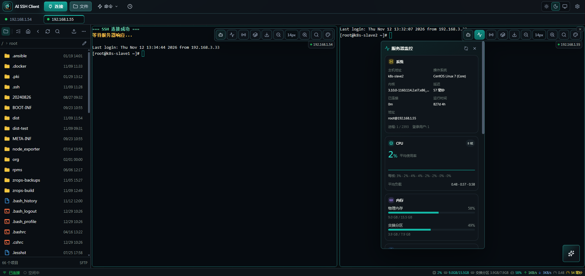
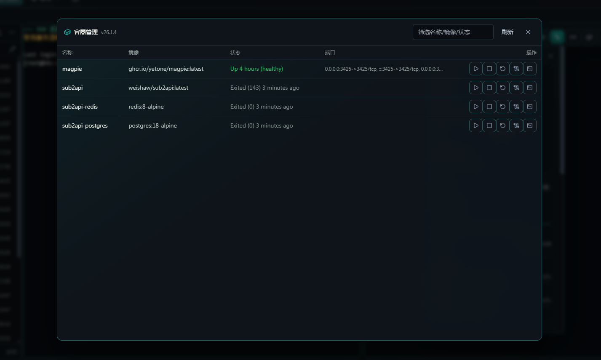

# AI SSH Client

一款自托管、浏览器直接使用的 SSH 工作台：完整终端、SFTP 文件管理、服务器监控、Docker 管理与可选的 AI 助手，全部由一个 Node.js 进程提供。无需安装桌面客户端，打开网址即可使用。

<p align="center">
  
</p>

<p align="center">
  
</p>

## 目录

- [功能特性](#功能特性)
- [截图](#截图)
- [快速开始](#快速开始)
- [Docker / Web 部署](#docker--web-部署)
- [安全](#安全)
- [面向 AI 的 MCP](#面向-ai-的-mcp)
- [快捷键](#快捷键)
- [技术栈](#技术栈)
- [项目结构](#项目结构)
- [开发](#开发)
- [数据与备份](#数据与备份)
- [贡献](#贡献)
- [开源协议](#开源协议)

## 功能特性

- **多会话 SSH** — 密码与私钥登录、多级跳板机、HTTP / SOCKS5 代理、断线重连与心跳保活。
- **分屏终端工作台** — 拖动标签即可左右 / 上下分屏，最多四屏同显，每屏标注所属服务器。
- **富终端** — 基于 xterm.js，支持搜索、主题、字号与回滚行数设置、命令历史、自动补全、括号粘贴，以及全屏程序（vim/nano）安全输入模式。
- **会话级 SFTP** — 浏览、上传、下载、编辑、重命名、改权限；文件夹递归传输、远程文件预览（图片、PDF、音视频流式播放）与远程文件搜索。
- **传输队列** — 单任务与批量暂停 / 继续，真断点续传，上传保留源文件修改时间。
- **端口转发** — 本地转发与动态 SOCKS5，在终端工具栏直接管理。
- **服务器监控** — 状态栏实时显示每核 CPU、内存、Swap、网络速率、磁盘 IO、负载、进程与延迟。
- **Docker 管理** — 容器列表、详情、启动 / 停止 / 重启、SSE 实时日志与进入容器 shell。
- **sudo 文件访问** — 无需离开浏览器即可通过 `sudo` 编辑 root 文件（按需弹窗输入密码，不落盘）。
- **命令广播** — 一次输入同步发送到当前所有可见分屏。
- **AI 助手与 Agent** — 自然语言 Linux 命令帮助与受控任务执行。
- **多 AI 供应商** — 兼容 OpenAI 的接口、Anthropic、Gemini 与 Ollama。
- **安全护栏** — 命令风险分析与危险操作审批，附带执行日志。
- **主机指纹校验** — SHA-256 主机密钥校验与首次连接信任提示。
- **快捷命令** — 可复用的命令片段，支持分组。
- **主题与设计令牌** — 亮色、暗色与跟随系统，统一由设计令牌驱动。
- **可移植配置** — 导入导出应用配置，支持导入 OpenSSH `config`。

## 截图

<div align="center">
  
  <br /><br />
  
</div>

## 快速开始

需要 Node.js 20+。

```bash
npm install

# 构建前端产物，然后启动 Web 服务（http://localhost:5080）
npm run web
```

`npm run web` 会先构建前端再启动 `server/index.cjs`。只调试前端时，可运行
`npm run dev:vite` 起 Vite 开发服务器，配合已启动的 `npm run web:only` 后端。

## Docker / Web 部署

```bash
docker compose up -d --build
```

打开 <http://localhost:5080>。通过 `AI_SSH_CLIENT_WEB_PORT` 修改宿主机端口。
同一局域网的其他设备可访问 `http://<局域网IP>:5080`；若需要从非 localhost
来源完成 SFTP 下载，请开启 HTTPS（`AI_SSH_CLIENT_WEB_TLS=1`），因为浏览器的
文件系统访问 API 要求安全上下文。

常用配置：

| 变量 | 作用 |
| --- | --- |
| `AI_SSH_CLIENT_WEB_PORT` | 宿主机映射到容器 `5080` 的端口。 |
| `AI_SSH_CLIENT_WEB_PASSWORD` | Web 界面访问密码（传入容器为 `WEB_AUTH_PASSWORD`）。 |
| `AI_SSH_CLIENT_WEB_TLS` | 设为 `1` 时首次启动生成自签名证书（`WEB_TLS`）。 |
| `WEB_TLS_CERT` / `WEB_TLS_KEY` | 使用自有 PEM 证书，替代自签名。 |
| `WEB_TLS_HOSTS` | 自签名证书 SAN 使用的域名 / IP，逗号分隔。 |
| `WEB_TLS_REGENERATE` | 设为 `1` 强制重新生成自签名证书。 |
| `WEB_HOST` | 绑定地址（`0.0.0.0` 对外暴露；Docker 下已默认设置）。 |
| `DATA_DIR` | 数据持久化目录（连接、设置、传输、TLS 材料）。 |
| `WEB_SSH_TRUST_ON_FIRST_USE` | 设为 `true` 自动信任未记录的主机指纹。 |
| `MCP_ALLOW_EXEC` | 设为 `1` 允许通过 MCP 执行命令（默认关闭）。 |

证书存放在 `DATA_DIR/tls/`，在过期、卷被删除或访问 IP 变化前会持续复用。
如需自行终止 TLS，可在 `127.0.0.1:5080` 前放置反向代理（如 Caddy）。

## 安全

- **主机密钥校验** — 每次连接都与已存 SHA-256 指纹比对，未知主机触发首次信任提示。
- **凭据加密** — SSH 密码、私钥与 AI API Key 写入磁盘前均以 AES-GCM 加密
  （`server/secret-store.cjs`）。
- **密码管理** — 通过 `WEB_AUTH_PASSWORD` 固定访问密码，加密密钥由它派生；
  修改或遗失密码会导致已存凭据无法解密。
- **下载需要 HTTPS** — 文件系统访问 API 要求安全上下文；局域网访问请使用
  `WEB_TLS=1` 或 TLS 终止代理。

## 面向 AI 的 MCP

`server/mcp/index.mjs` 是可选的标准输入输出（stdio）MCP 服务器，把已保存的
Web 模式连接暴露给 Claude Code、Cursor、DSH 等 MCP 客户端。Web 网关同时提供
**Streamable HTTP 端点 `/mcp`**（`Authorization: Bearer <访问密码>`），客户端
只需一个地址，连接与策略都留在服务端。

```bash
npm run mcp          # 本地 stdio（需要可访问数据目录）
npm run web          # 网关在 http://<host>:5080/mcp 暴露
```

除非为部署启用 `MCP_ALLOW_EXEC=1`，否则通过 MCP 执行命令默认关闭。

## 快捷键

| 快捷键 | 功能 |
| --- | --- |
| `Ctrl/Cmd + T` | 新建连接标签 |
| `Ctrl/Cmd + W` | 关闭当前标签 |
| `Ctrl/Cmd + F` | 终端搜索 |
| `Ctrl/Cmd + +` / `-` | 增大 / 减小字号 |
| `Ctrl/Cmd + Shift + P` | 命令面板 |
| `Esc` | 中断正在运行的 AI Agent 任务 |

## 技术栈

- **前端** — React 18、TypeScript、Vite、Tailwind CSS（语义化设计令牌）、xterm.js、CodeMirror、Zustand。
- **后端** — Node.js + Express，`ssh2` 负责 SSH/SFTP，`ws` 负责终端与流式通道，SSE 负责容器日志。
- **存储** — `DATA_DIR` 下的 JSON 文件，密钥类数据以 AES-GCM 加密。

## 项目结构

```
server/             Node.js Web 服务（SSH、SFTP、监控、Docker、MCP、鉴权）
src/renderer/       React 前端（工作台、终端、传输、设置）
src/shared/         共享类型与 IPC/API 契约
docs/               截图与设计文档
scripts/            构建与设计系统检查脚本
test/               Vitest 测试
```

## 开发

| 命令 | 说明 |
| --- | --- |
| `npm run dev:vite` | 前端开发服务器 |
| `npm run web:only` | 仅启动后端 |
| `npm run build:renderer` | 构建前端产物 |
| `npm run typecheck` | 前端类型检查 |
| `npm run test` | 运行 Vitest 测试 |
| `npm run check` | 类型检查 + 测试 + 前端构建 |
| `npm run mcp` | 启动 stdio MCP 服务器 |

提交 PR 前请先运行 `npm run check`。

## 数据与备份

状态保存在 `DATA_DIR`（默认 `./data`）：`connections.json`、`settings.json`、
`sftp-transfers.json`、TLS 材料与加密密钥库。请整体备份该目录，并保留
`secret.key`（或保持相同的 `WEB_AUTH_PASSWORD`），以保证已加密凭据仍可解密。

## 贡献

欢迎提交 Issue 与 Pull Request。请保持改动聚焦，为行为变化补充测试，并先运行
`npm run check`。

## 开源协议

见 [LICENSE](LICENSE)。
